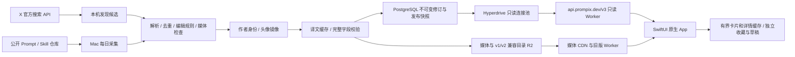

# Prompix 技术方案 v0.9

更新：2026-10-15。0.7.0 保持 SwiftUI 原生客户端和受预算保护的 Mac 输入管线，内容主存储已升级至独立 PostgreSQL，列表、搜索和详情使用 v3 API。R2 继续保存媒体及旧客户端兼容版本。实现与测试见[数据库 Feed](database-feed-v3.md)，候选包见[0.7.0 验收](release-0.7.0.md)。历史目录协议的能力与上限仍适用于旧客户端。

## 当前架构

- `api.prompix.dev` 提供只读内容；`prompix.dev` 已部署中英文官网、帮助、隐私和内容反馈页面。官网并未随客户端扩展为九种语言。
- `services/content/` 是只读 Worker，绑定专用 `prompix-content` R2 bucket。无公开写入接口、用户数据库或登录。
- `services/feed/` 提供分页、详情、搜索、作者、专题和下架变更。数据库 Data API 关闭，RLS 和最小权限角色隔离公开读取与输入发布；App 不持有数据库凭据。全库发布事务、跨通道恢复与维护方法见[运维规程](database-operations.md)。
- Mac 用户级 launchd 在本机时间 02:00、08:00、14:00、20:00 执行采集；机器睡眠或关机时不能保证准点执行。运行环境独立安装在仓库外，不依赖临时 worktree。
- 本机凭据位于 `~/.config/prompix/*.env`，候选、发布目录、日志位于 `~/.local/share/prompix/`，均不进入 Git。

## 内容采集与选编

新增来源由独立 X 官方 API 搜索、prompts.chat CSV、35 个 Anthropic/OpenAI 官方 Skill 目录和 ClawHub 白名单构成。四个 YouMind OpenLab 仓库和旧视频归档已停止新增采集，只保留历史发布条目的署名与稳定 ID。GitHub 源固定 commit；Skill 保留完整 `SKILL.md` 和已核验文件路径，源目录入口固定到同一提交，不在采集器或手机上执行。

YouMind 公开的 [同步工作流](https://github.com/YouMind-OpenLab/awesome-nano-banana-pro-prompts/blob/main/.github/workflows/update-readme.yml) 每 4 小时将其 CMS 内容导出到 GitHub，另有审核投稿同步；公开仓库并不等于完整的 X 采集系统。本项目独立实现来源适配、编辑规则和发布流程。

`npm run daily` 只采集和本地预览；`npm run daily -- --publish` 额外镜像媒体并发布。完整库选择使用当前指纹编辑记录、内容条件与全局去重，不再截断每个来源或模态的条数。编辑优先级与上游标记控制排序，四类内容交错展示；未经整理的候选不会直接上线。内容状态记录候选、已审、合格、准备发布和实际发布的分类型数量，以及相对线上已校验目录的新增／移除数。相同版本重复运行明确记为零新增。

X 使用专用应用的 app-only Bearer Token，按文本、图片、视频、网页、Skill 五个主题独立搜索，保存分页窗口与完整长文、作者和附件关联。本机搜索额度每日 8 请求 / 400 帖；原帖复查另限 2 请求 / 200 帖。每次先持久化预留，失败不自动付费重试；不通过重置日期清空额度。完整作者、原帖和时间齐备后进入绑定来源版本的编辑审核，再核对真实预览。复查记录阻止保留机制恢复已修改或撤回的旧帖，明确不可用进入移除清单。媒体与头像从白名单下载、校验、镜像到自己的域名；没有完整指令的推广帖不发布。实现与实跑见 [自建采集升级](independent-pipeline.md)。

作者按平台与稳定身份聚合，不按显示名合并。已取得数字 ID 的 X 作者使用稳定 ID，账号别名可合并；仅有可信来源链接时保留规范账号身份。头像从 allowlist 获取、验证并缩至最长边 400 px 后镜像到自己的内容域名。照片失败保留作者及作品，客户端显示首字母。

原始内容只当数据处理，采集器不执行 Prompt 或网页代码。媒体下载限制来源主机、跳转主机、大小、超时和文件类型；图片用系统 sips 生成最长边 1200 px 的 JPEG，视频校验 MP4 头并限制 60 MB。抓取失败保留来源上次快照，过少有效预览时不切换当前线上版本。

## 翻译与发布协议

界面字符串在 `Localizable.xcstrings` 中维护九个 locale。内容翻译在仓库外分批处理，按源指纹和语言缓存；源内容改变使旧翻译失效。变量、代码、URL、JSON 键、参数与 Skill frontmatter 使用受保护片段校验。只有完整且通过结构检查的语言记录才附加到目录，语义与用词仍需抽查。

通用 daily 默认读取已校验缓存，不自动调用模型；显式启用的翻译配置控制提供方、模型、每日请求与费用预算。初次全量与每日增量共用锁和持久账本，断点续跑不重译已通过的片段。当前本机 CLI 使用已验证可用的 `gpt-5.6-luna`，先前通过校验的 Terra 批次继续复用；API 与 CLI 的模型、额度及账单独立，实际配置以 [翻译运行手册](translation-operations.md) 和外部报告为准。单独翻译命令不发布线上内容。

v3 实际契约以 `packages/schema/feed.ts`、`services/feed/http.ts` 和原生 `FeedModels.swift` 为准；详情沿用 `catalog.ts` / `Prompt.swift` 的严格内容验证。`/v3/feed`、`contents/:id`、`creators`、`browse`、`state`、`removals` 均为只读、有界 JSON，使用 no-store 和最小权限数据库角色。旧版对象协议继续如下：

- `v1/latest.json`：schemaVersion、version、count、publishedAt、sha256、目录 HTTPS URL。
- `releases/<version>/catalog.json`：完整目录、可选 `removedIDs`、来源与媒体元数据。
- `media/<sha256>.jpg|mp4`：内容寻址，跨次运行复用已上传素材。
- 内置原创内容仍可使用 Bundle 资源名；社区预览使用自有 API 域名的 `imageURL`／`videoURL`。
- 可选 `creator` 包含稳定 ID、平台、显示名、主页、账号、数字 ID、简介和自有域名头像。
- 为兼容旧 v1 客户端，四个 `kind` 不变；Skill 使用 `kind: text`、`contentType: skill` 和 `skill` 元数据。新版以独立 Skill 类型展示；旧版仍可阅读其正文。
- 可选 `localization` 保存源语言、源指纹和按 locale 索引的完整译文。每个版本包含标题、摘要、正文、示例、预览说明和可选封面文案，原始字段不覆盖。

数据库模式先准备媒体、不可变数据库发布和兼容目录，验证后依次激活 DB/v2/v1；跨服务失败由持久 intent 续完同一目标，见数据库 Feed 文档。旧内容 Worker 的 GET／HEAD 继续支持 ETag 304、视频 Range 206；其他方法返回 405，私有路径返回 404。没有开放任意代理或上传能力。

`npm run remove -- <id> <reason>` 更新本机移除清单，下一次发布启用。客户端删除对应收藏快照及原文／各语言草稿。离线设备只能在联网刷新后获知移除；旧发布文件并非立即物理删除，紧急媒体撤回需额外删除对象并处理缓存。

## iOS 实现

- Swift 6、iOS 17+，无第三方 Swift 依赖。SwiftUI 原生 TabView、NavigationStack、搜索、菜单、分享、编辑与收藏。
- 首页包含创作者、用途专题和完整信息流，筛选后直接显示结果。未筛选首页即使使用没有作者元数据的旧缓存，也保留创作者标题和目录入口，并提供空态说明与更新操作。紧凑宽度双列、常规宽度三列；辅助大字或 VoiceOver 使用单列，作者栏改为可读行。Tab 使用 SF Symbols，保留系统原生导航。
- 公开内容按关键词、类型、用途、模型和作者在数据库过滤，搜索展示内容与作者入口；收藏和离线回退继续本地筛选，最近搜索只保存在本机且可清除。专题与相关内容按标签匹配，没有虚构热度或个性化推荐。
- 作者目录、主页、真实收录数量、类型筛选、原平台链接和本机收藏已实现。头像、卡片署名和详情署名指向同一作者身份；收藏作者不产生外部平台关注。
- 界面跟随系统或 App 语言设置；正文默认选可用的当前语言译文，明确标示 AI 译文或原文。语言选择影响详情、复制、编辑和分享；无匹配译文时返回原文，不改用无关语言。显式中文 script 优先于地区推断。
- 启动／回到前台检查发布与下架状态，已有缓存或内置内容继续可读。每个分页查询和全库元数据在五分钟内可复用当前成功结果；显式刷新重新请求，切换查询取消旧结果归属。原先 v1/v2 的完整目录下载器仅保留兼容和测试用途，普通 v3 浏览不再自动下载全库。
- v3 使用无持久 URL 缓存的临时 URLSession，请求超时 20 秒、资源超时 30 秒，每主机最多四个连接。页面默认最多 1,000,000 字节、详情 2,000,000 字节、状态 16,384 字节、下架页 150,000 字节；按接收块累计限额，要求原始完整 URL 和 JSON MIME。429 的 Retry-After 在各入口间共享，不能通过切换页面绕过。
- 列表明确显示加载、缓存回退、失败重试和分页状态，详情先校验不可变修订及语言。下架 checkpoint、收藏和草稿通过既有恢复日志提交；失败或取消不切换半成品结果，不因当前页没有某项而删除个人数据。
- 图片按需请求、下采样，NSCache 40 MB、URLCache 磁盘预算 80 MB；原生 UIScrollView 缩放。视频 AVKit 点击播放，离开或进入后台暂停，列表不自动播放。
- 内容与作者收藏分别写入 `favorites.json` 和 `creators.json`，草稿写入 `drafts.json`；均为本机原子持久化。内容快照仅在原始正文完全一致时补充新译文和作者元数据，源正文改变则保留原快照。原文草稿保留旧 ID，各译文使用独立语言键；恢复一份草稿不影响其他语言。
- 收藏内容封面、其作者头像和收藏作者头像单独保留在 Application Support，清理浏览缓存不删除这些资源。任一收藏文件无法读取时暂停保留集合的清理，阻止覆盖并提供恢复。普通浏览图片仍可被缓存淘汰；完整视频不离线下载。
- 六个原创网页示例在隔离 WKWebView 中展示：只允许指定本地文件、临时数据存储、限制文件导航和网络的 CSP，并启用本地交互所需 JavaScript；外部工具与网页演示打开系统浏览器。
- 草稿在短暂防抖、结束编辑和进入后台时保存；写入失败保留缓冲，提供重试或明确退出选择。系统分享包含当前正文及来源，不自动上传私人草稿；公开搜索词会传给 v3 服务完成查询，没有新增分析 SDK 或崩溃 SDK。

## 验证与运维

`npm test`、`npm run typecheck` 检查解析、来源、创作者、Skill、翻译与协议；`scripts/check-localizations.py` 检查界面资源覆盖。iOS 单测覆盖收藏、独立语言草稿、升级补全、身份分组、语言回退、校验失败和恢复。0.3.1 增加无作者的 68 条缓存升级为 345 条合成内容并保留收藏／草稿、失败节流、取消后重试、分块进度、压缩长度和大小上限场景。UI 场景验证发现、作者、Skill、语言选择、收藏、编辑、复制和媒体入口。`npm run check:deployment` 检查实际线上哈希、完整响应、条件请求、分段视频、HEAD 和只读边界。已执行的结果与待完成场景应在验收记录中分别列出。

安装、日志、故障恢复和费用控制见 [内容运行手册](content-operations.md)。当前优先完成视觉改版与旧缓存更新的实际模拟器验收；以后进入商店阶段时再核对设备性能、网络、商店材料与申报。九语字符串齐全不等于专业母语审校，内部测试也不等于编辑推荐或用户验收通过。

数据库保存完整内容库；v1/v2 按旧客户端的 1,000 条、解码 10,000,000 字节上限生成兼容窗口，完整库不再被这个窗口截断。旧版本重试仍复用原始对象字节和 SHA。数据库回滚使用完整 `feed-...` 版本，禁止将旧窗口误当全库。

旧版全目录曾达到 7.83 MB，紧凑编码无法解决长期增长。v2 已按语言分包；0.7.0 进一步按页和详情请求，并有缓存容量、响应字节与查询时间限制。一万条验证与尚未覆盖的并发/网络边界见数据库 Feed 记录，不能单方面提高服务端限制让旧手机拒收。

## 2026-10-13 采集架构修订

供给从聚合站导出迁移到原始来源适配器。X 使用按主题分离的分页状态及持久化付费预算；Skill 直接读取固定提交的作者目录。历史 OpenLab 内容只保留既有发布与署名。原生客户端新增独立工具交接模型与使用面板。实现边界见[自建采集升级](independent-pipeline.md)。
