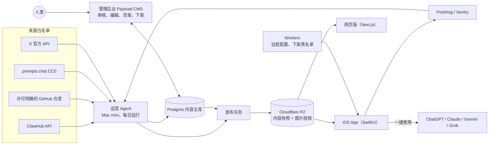

# Prompix 技术方案 v0.3（讨论稿）

更新：2026-10-11　状态：讨论稿。运营 Agent 的框架选型完成后定稿。

## 1. 目标与约束

- 开源（MIT）、免费，无广告、无内购，运行成本必须低；性能与稳定性优先。
- 第一版：iOS 原生 App，除中国大陆外的全部地区上架；网页版同步上线。之后单独做 Android 原生 App。
- 研发主要由 AI Agent 完成。
- 内容运营由运营 Agent 闭环完成；人类通过管理后台查看、修改和兜底。
- 第一版不做账号、社区、App 内生成；收藏存在本机。
- 不做自产样图和多模型实测：样图用创作者公开发布、并经许可明确的上游仓库收录的图片，署名并链接原帖。
- 模型通过 OpenAI 兼容接口接入，可以替换。默认文本判断、翻译、打标签用 DeepSeek，看图判断用通义千问的视觉模型。

## 2. 总体架构

核心思路是"静态优先"：App 和网页读取的都是发布到 CDN 上的内容快照，不直接查数据库。用户再多，后端压力也几乎不变；CDN 出问题时 App 仍能离线使用。

## 3. 内容来源与展示级别

| 来源 | 获取方式 | 许可 | 展示级别 |
|---|---|---|---|
| ClawHub | 公共 API，免鉴权 | Skill 统一 MIT-0，要求回链 | 全文 |
| Anthropic 等官方 Skill 仓库 | GitHub API | 多为 Apache-2.0，docx/pdf/pptx/xlsx 四个是专有许可 | 按文件夹判定 |
| prompts.chat | CSV、API | CC0 | 全文 |
| 许可明确的图像提示词仓库（EvoLink、freestylefly、jamez-bondos、PicoTrex、MeiGen 等） | GitHub | CC0 / MIT / Apache / CC BY | 全文 + 署名；图片权利属于原作者，需要作者认领和下架机制 |
| X 官方 API（按量付费） | 关键词检索热帖 | 遵守 X 开发者条款，原帖删除后同步删除 | 按条款展示，署名并链接原帖 |
| 没有许可证的仓库、禁止抓取的站点 | 不抓取 | — | 不收录，或只放链接 |

行业现状：主流提示词站基本不自己出图。样图大多是 X 创作者原帖里的图，要么直接热链，要么转存到自己的存储；很多提示词是从图片逆向推出来的。只有少数库做了复测或自产，规模都很小。所以第一版不自产样图。差异化放在体验、精选和来源透明（标注作者原文 / 逆向 / 改写）上。

样图转存到 R2 并生成多种尺寸，原因是列表要快，热链原图会拖慢瀑布流；而且原帖删除后热链会失效。代价是我们持有副本，所以下架必须快。

## 4. 运营 Agent

### 4.1 设计原则

- **确定性流水线是骨架，Agent 负责判断和开放式任务。** 抓取、去重、许可判定、发布这些用代码写死，保证稳定、可测、可回滚；挑选、写标题、分类、排货架、处理异常这些需要判断的事交给大模型。
- **硬规则不交给模型。** 许可证白名单、成人内容拦截、来源白名单、每日上架数量上限都是代码规则，模型不能越过。
- **处理外部内容的模型调用不给工具。** 抓来的网页、帖子、README 都是不可信内容，评估这类内容的模型只输出结构化结果，不能执行命令或访问网络，避免被内容里藏的指令带偏。
- **每个动作都留痕。** 记录做了什么、为什么做、依据是什么，管理后台可以逐条追溯。
- **人类说了算。** 人类改过或锁定的条目，Agent 不再改动；后台有总开关，可以随时暂停自动上架。
- **好管理。** 一条命令或后台一个开关就能启动、停止、暂停，随时能查看运行状态和日志。

### 4.2 每日循环

1. **发现**：从白名单来源拉取新内容，结合趋势信号（上游仓库的新增和星数变化、X 热帖、我们自己 App 里的热度）生成候选。
2. **评估**：许可检查 → 去重（正文哈希、近似重复、X 帖子 ID）→ 安全检查（成人内容、知名 IP 角色、越狱、泄露的系统提示词）→ 质量打分（看图模型判断画面质量、提示词与图片是否对得上）。
3. **包装**：写英文标题和摘要，打分类和标签，提取变量，确定"最适合的 App"，标注来源类型（作者原文 / 逆向 / 改写）。Skill 另外生成"做什么、在哪能用、怎么装"，抓取来源平台的检测结果，固定 commit。
4. **决策**：同时满足"许可通过、安全通过、分数达标、不重复"的自动上架，否则进入人工审核队列。每天上架数量有上限，保证首页质量。上线后前两周先全部进人工审核，校准阈值后再放开自动上架。
5. **排货架**：刷新热门、最新和各地区的首屏货架，按各地节日日历组织专题，轮换首页横幅。
6. **发布**：生成内容快照，先发到预发布环境做检查（链接是否有效、图片能否加载、数据格式是否正确），通过后再上线，失败自动回滚。
7. **学习**：读取 PostHog 数据（曝光 → 详情 → 复制 → 打开哪个 App），表现差的降权，表现好的同类多找。
8. **维护**：处理下架申请（几小时内移除并记录）、巡检失效链接、上游许可或内容变化时重新检查。
9. **汇报**：每天给人类发一份日报（新增、下架、核心数据、异常、花费），可以发到飞书、Slack 或邮件。

### 4.3 运行环境

- 开发阶段在 MacBook 上调试，生产环境放在 Mac mini 上。
- 来源和 Cloudflare 都需要国际网络：Agent 支持通过环境变量配置代理，网络异常时自动重试并告警。
- 调度：每天一次完整循环；每小时一次轻量检查，处理下架申请和失效链接。
- 框架：选型中，候选为 OpenClaw、Hermes Agent 和代码优先的方案（Agent 库 + 调度器）。

### 4.4 管理后台（给人类用）

用 Payload CMS 搭在 Postgres 上，自带登录、权限和编辑界面，Agent 通过它的 API 写入。功能包括：

- 审核队列：通过、拒绝、编辑。
- 条目编辑：可以锁定，锁定后 Agent 不再改动。
- 货架和专题编辑：可以按地区配置。
- 下架申请收件箱。
- Agent 运行记录：每次运行做了什么、为什么。
- 数据看板和花费。
- 设置：来源白名单、分数阈值、每日上限、预算、自动上架总开关。

## 5. iOS 客户端

- 技术栈：SwiftUI，最低支持 iOS 17。
  - 瀑布流用 UIKit 的 UICollectionView 自定义布局，大量图片和视频滚动时性能最好；其余界面用 SwiftUI。
  - 图片加载和缓存用 Nuke，支持预取和渐进解码。
  - 视频用 AVFoundation，复用播放器，同一时间只播放屏幕上的 1–2 个。
  - 本地数据用 GRDB（SQLite，带 FTS5 全文搜索），存放内容目录、搜索索引和收藏。
- 数据：安装包里内置一份种子快照；启动时检查版本清单，只下载增量；完全离线也能浏览已有内容和收藏。
- 推荐（不需要账号）：编辑精选 + 全站热度 + 本机兴趣重排；首屏货架和目标 App 的排序按地区切换，例如印度、东南亚、日本把 Gemini 排第一。
- 一键使用：

| App | iOS 做法 |
|---|---|
| ChatGPT | 通用链接 `chatgpt.com/?prompt=`，直接带入 |
| Grok | 通用链接 `grok.com/?q=`，直接带入 |
| Gemini | 复制到剪贴板后打开 Gemini，首次弹出粘贴引导 |
| Claude | 复制到剪贴板后打开新对话 |

  - 链接模板放在远程配置里，厂商改规则时不用发版。
  - 打开失败时退回"复制 + 打开"，文案统一写"打开并填入"，不承诺自动发送。
  - 需要照片的提示词，统一走"文字放剪贴板 + 打开 App + 用户自己加图"。
- 原生能力：v1 做离线收藏和一键交接；v1.1 加分享扩展、键盘扩展和快捷指令。

Android 版之后用 Kotlin + Jetpack Compose 单独开发：瀑布流用 LazyVerticalStaggeredGrid，视频用 Media3，图片用 Coil，本地库用 Room。Gemini 在 Android 上可以通过系统分享直接带入提示词。

## 6. 网页版

- Next.js 静态生成，和 App 用同一份内容快照，部署在 Cloudflare。
- 作用：
  - 搜索引擎收录；
  - 分享链接的落地页，以及 iOS 通用链接的跳转页；
  - "发到电脑"安装 Skill 时打开的页面；
  - 在 App 上线前先按国家收集使用数据。

## 7. 后端

- 内容主库用 Postgres，管理后台用 Payload CMS，和运营 Agent 一起部署在 Mac mini 上。
- Cloudflare Workers 负责远程配置、版本清单、下架申请表单和短链。
- 第一版没有用户数据库。

## 8. Skill

- 来源：ClawHub、官方仓库、许可宽松的 GitHub 仓库，许可证按 Skill 所在文件夹判定。
- 只展示来源平台自带的检测结果；来源没有检测的，不显示这一项。
- 获取方式：
  - 复制 `npx skills add` 安装命令，固定到收录时的 commit，防止作者事后改动内容；
  - 通过分享面板把链接发到电脑；
  - 跳转到 ChatGPT 插件目录里对应的条目；
  - 拆成名称、描述、指令三段，方便在 Gemini 里手动创建。

## 9. 合规与运营

- 来源台账逐条记录；作者认领和下架流程：GitHub issue 或表单 → Agent 自动处理并记录 → 从下次快照中移除，紧急情况走远程黑名单。
- 在"关于"页和 App Store 描述里写明与 OpenAI、Anthropic、Google、xAI 均无关联。不用这些厂商的 logo，也不把它们的品牌名放进 App 名称。
- 隐私政策：不收集个人信息，埋点匿名。
- App Store 审核准备：原生功能（离线收藏、一键交接）是过 4.2 条款的依据；每个来源的授权依据都能随时出示（5.2.2）。

## 10. 监控

- PostHog：埋点和转化漏斗（曝光 → 详情 → 使用 → 选择哪个 App），同时作为运营 Agent 的数据输入。
- Sentry：App 崩溃和错误。
- 运营 Agent 失败时告警。

## 11. 成本估算（10 万月活）

| 项目 | 每月 |
|---|---|
| Cloudflare R2 存储与请求、Workers | $15–30 |
| Mac mini（自有，运行 Agent、Postgres、Payload） | 电费 |
| DeepSeek、通义千问 | 首次约 $50 / 10 万条，之后每月个位数到几十美元 |
| X 官方 API | 约 $30–100 |
| PostHog | 每月 100 万事件以内免费，超出后约 $0–200（可以采样） |
| Sentry | 免费额度 |
| 合计 | 约 $50–350 |

另有 Apple 开发者账号 $99/年、域名费用。

## 12. 里程碑

| 阶段 | 内容 |
|---|---|
| M0 | 运营 Agent MVP（来源接入、评估、发布）、管理后台、首批 2–5 千条内容、网页版骨架 |
| M1 | iOS v1 主流程（设计稿 V2 的 10 屏）、埋点、TestFlight 内测、真机深链测试 |
| M2 | App Store 上架；运营 Agent 从"人工审核"切换到"自动上架 + 抽检" |
| M3 | Android 原生版、日语本地化 |

## 13. 品牌

- 名称：Prompix。App Store 名称用"Prompix: AI Image Prompts"这类格式，让副标题承担搜索关键词。
- 视觉：近黑底色加亮绿强调色，标题字体 Space Grotesk，界面字体 Manrope。

## 14. 待定

1. 运营 Agent 的框架选型（调研中）。
2. 域名与商标：注册 prompix.ai，并在美国和欧盟商标库检索"Prompix"。
3. Apple 开发者账号的注册主体（需要邓白氏编码）。
