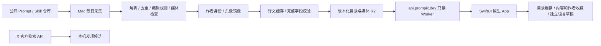

# Prompix 技术方案 v0.8

更新：2026-10-12。0.3.0 已增加结构化创作者、Agent Skill、九个 locale 的界面与增量内容翻译，并按用户要求安装到测试手机。0.3.1 保持 iOS Native、Mac 本地轻量采集和静态发布，采用 [Granola 参照设计](design-granola-2026-10.md)，补齐旧缓存状态下的创作者入口、更新进度与重试体验。346 条内容的九语言完整记录已发布，真实68→346升级与完整目录性能已在模拟器验证，完成关口见 [next-release.md](next-release.md)。

## 当前架构

- `api.prompix.dev` 提供只读内容；`prompix.dev` 已部署中英文官网、帮助、隐私和内容反馈页面。官网并未随客户端扩展为九种语言。
- `services/content/` 是只读 Worker，绑定专用 `prompix-content` R2 bucket。无公开写入接口、用户数据库或登录。
- Mac 用户级 launchd 每天本机时间 08:00 执行采集；机器睡眠或关机时不能保证准点执行。运行环境独立安装在仓库外，不依赖临时 worktree。
- 本机凭据位于 `~/.config/prompix/*.env`，候选、发布目录、日志位于 `~/.local/share/prompix/`，均不进入 Git。

## 内容采集与选编

`ingest/sources.ts` 明确列出来源：YouMind OpenLab 的 Nano Banana Pro、GPT Image 2、Seedance 2 公开仓库、prompts.chat CSV，以及 Anthropic/OpenAI 官方 Skill 中允许收录的目录。每次解析固定 commit 的文件，保留作者、原始链接、上游仓库与版本。Skill 保留完整 `SKILL.md` 和已核验文件路径；源目录入口固定到同一提交，不在采集器或手机上执行。

YouMind 公开的 [同步工作流](https://github.com/YouMind-OpenLab/awesome-nano-banana-pro-prompts/blob/main/.github/workflows/update-readme.yml) 每 4 小时将其 CMS 内容导出到 GitHub，另有审核投稿同步；公开仓库并不等于完整的 X 采集系统。本项目独立实现来源适配、编辑规则和发布流程。

`npm run daily` 只采集和本地预览；`npm run daily -- --publish` 额外镜像媒体并发布。完整库选择使用当前指纹编辑记录、内容条件与全局去重，不再截断每个来源或模态的条数。编辑优先级与上游标记控制排序，四类内容交错展示；未经整理的候选不会直接上线。内容状态记录候选、已审、合格、准备发布和实际发布的分类型数量，以及相对线上已校验目录的新增／移除数。相同版本重复运行明确记为零新增。

X 使用专用应用的 app-only Bearer Token，日常搜索最多一次、10 条结果，不自动重试收费请求。搜索复用 `author_id` expansion 和用户字段取得真实 ID、账号、姓名、简介及头像。先写尝试记录，再请求，失败不推进帖子游标；X 帖子先进入本机候选，不绕过编辑审核直接发布。额外作者补全默认关闭，显式启用后按 UTC 日限额与负缓存控制请求；初次补全和日常请求分别记账，见 [创作者与 Skill](creators-and-skills.md)。

作者按平台与稳定身份聚合，不按显示名合并。已取得数字 ID 的 X 作者使用稳定 ID，账号别名可合并；仅有可信来源链接时保留规范账号身份。头像从 allowlist 获取、验证并缩至最长边 400 px 后镜像到自己的内容域名。照片失败保留作者及作品，客户端显示首字母。

原始内容只当数据处理，采集器不执行 Prompt 或网页代码。媒体下载限制来源主机、跳转主机、大小、超时和文件类型；图片用系统 sips 生成最长边 1200 px 的 JPEG，视频校验 MP4 头并限制 60 MB。抓取失败保留来源上次快照，过少有效预览时不切换当前线上版本。

## 翻译与发布协议

界面字符串在 `Localizable.xcstrings` 中维护九个 locale。内容翻译在仓库外分批处理，按源指纹和语言缓存；源内容改变使旧翻译失效。变量、代码、URL、JSON 键、参数与 Skill frontmatter 使用受保护片段校验。只有完整且通过结构检查的语言记录才附加到目录，语义与用词仍需抽查。

通用 daily 默认读取已校验缓存，不自动调用模型；显式启用的翻译配置控制提供方、模型、每日请求与费用预算。初次全量与每日增量共用锁和持久账本，断点续跑不重译已通过的片段。当前本机 CLI 使用已验证可用的 `gpt-5.6-luna`，先前通过校验的 Terra 批次继续复用；API 与 CLI 的模型、额度及账单独立，实际配置以 [翻译运行手册](translation-operations.md) 和外部报告为准。单独翻译命令不发布线上内容。

实际契约以 `packages/schema/catalog.ts` 和 `ios/Prompix/Models/Prompt.swift` 为准。

- `v1/latest.json`：schemaVersion、version、count、publishedAt、sha256、目录 HTTPS URL。
- `releases/<version>/catalog.json`：完整目录、可选 `removedIDs`、来源与媒体元数据。
- `media/<sha256>.jpg|mp4`：内容寻址，跨次运行复用已上传素材。
- 内置原创内容仍可使用 Bundle 资源名；社区预览使用自有 API 域名的 `imageURL`／`videoURL`。
- 可选 `creator` 包含稳定 ID、平台、显示名、主页、账号、数字 ID、简介和自有域名头像。
- 为兼容旧 v1 客户端，四个 `kind` 不变；Skill 使用 `kind: text`、`contentType: skill` 和 `skill` 元数据。新版以独立 Skill 类型展示；旧版仍可阅读其正文。
- 可选 `localization` 保存源语言、源指纹和按 locale 索引的完整译文。每个版本包含标题、摘要、正文、示例、预览说明和可选封面文案，原始字段不覆盖。

先上传媒体与目录，重新下载目录核对 SHA-256，最后覆盖 latest 指针。失败保持旧版；相同内容版本不重复发布。Worker 仅允许公开路径的 GET／HEAD，支持 ETag 304、视频 Range 206；其他方法返回 405，私有路径返回 404。没有开放任意代理或上传能力。

`npm run remove -- <id> <reason>` 更新本机移除清单，下一次发布启用。客户端删除对应收藏快照及原文／各语言草稿。离线设备只能在联网刷新后获知移除；旧发布文件并非立即物理删除，紧急媒体撤回需额外删除对象并处理缓存。

## iOS 实现

- Swift 6、iOS 17+，无第三方 Swift 依赖。SwiftUI 原生 TabView、NavigationStack、搜索、菜单、分享、编辑与收藏。
- 首页包含创作者、用途专题和完整信息流，筛选后直接显示结果。未筛选首页即使使用没有作者元数据的旧缓存，也保留创作者标题和目录入口，并提供空态说明与更新操作。紧凑宽度双列、常规宽度三列；辅助大字或 VoiceOver 使用单列，作者栏改为可读行。Tab 使用 SF Symbols，保留系统原生导航。
- 本地按关键词、类型、用途、模型和作者过滤；搜索展示内容与作者入口，最近搜索保存在本机且可清除。专题与相关内容按标签匹配，没有虚构热度或个性化推荐。
- 作者目录、主页、真实收录数量、类型筛选、原平台链接和本机收藏已实现。头像、卡片署名和详情署名指向同一作者身份；收藏作者不产生外部平台关注。
- 界面跟随系统或 App 语言设置；正文默认选可用的当前语言译文，明确标示 AI 译文或原文。语言选择影响详情、复制、编辑和分享；无匹配译文时返回原文，不改用无关语言。显式中文 script 优先于地区推断。
- 启动／回到前台检查更新，已有缓存或内置内容继续可读。当前进程内，成功检查后自动尝试间隔为 15 分钟；失败后缩短为距上次尝试 30 秒，此后的前台事件或非强制刷新才可再次触发，不设 30 秒自动重试定时器。任务取消后清除尝试时间，下次触发可立即重试。下拉刷新及显式重试绕过节流，但不并发执行第二个更新。
- 内容请求使用 `URLRequest.timeoutInterval = 60`，并通过任务级 `URLSessionDataDelegate` 按块接收；这不是整个更新的 60 秒总时限。清单最多 32,000 字节，目录最多 10,000,000 字节；除响应头检查外，每个块在追加前检查累计大小，未知或不实的 Content-Length 不能绕过上限。只接受 HTTP 200、HTTPS 和原主机响应／跳转。进度约每 100 毫秒合并一次，另报告开始与结束；压缩响应在完成前不使用压缩后的长度计算解码内容百分比。
- 更新状态区分检查、下载、安装、最新和失败，发现页显示进度及失败重试。SHA-256、解码和目录校验在非主 actor 的异步函数中执行；通过校验后再进入既有目录及个人数据的原子事务，失败或取消不切换到半成品目录。
- 图片按需请求、下采样，NSCache 40 MB、URLCache 磁盘预算 80 MB；原生 UIScrollView 缩放。视频 AVKit 点击播放，离开或进入后台暂停，列表不自动播放。
- 内容与作者收藏分别写入 `favorites.json` 和 `creators.json`，草稿写入 `drafts.json`；均为本机原子持久化。内容快照仅在原始正文完全一致时补充新译文和作者元数据，源正文改变则保留原快照。原文草稿保留旧 ID，各译文使用独立语言键；恢复一份草稿不影响其他语言。
- 收藏内容封面、其作者头像和收藏作者头像单独保留在 Application Support，清理浏览缓存不删除这些资源。任一收藏文件无法读取时暂停保留集合的清理，阻止覆盖并提供恢复。普通浏览图片仍可被缓存淘汰；完整视频不离线下载。
- 六个原创网页示例在隔离 WKWebView 中展示：只允许指定本地文件、临时数据存储、限制文件导航和网络的 CSP，并启用本地交互所需 JavaScript；外部工具与网页演示打开系统浏览器。
- 草稿在短暂防抖、结束编辑和进入后台时保存；写入失败保留缓冲，提供重试或明确退出选择。系统分享包含当前正文及来源，没有上传私人草稿、搜索词、分析 SDK 或崩溃 SDK。

## 验证与运维

`npm test`、`npm run typecheck` 检查解析、来源、创作者、Skill、翻译与协议；`scripts/check-localizations.py` 检查界面资源覆盖。iOS 单测覆盖收藏、独立语言草稿、升级补全、身份分组、语言回退、校验失败和恢复。0.3.1 增加无作者的 68 条缓存升级为 345 条合成内容并保留收藏／草稿、失败节流、取消后重试、分块进度、压缩长度和大小上限场景。UI 场景验证发现、作者、Skill、语言选择、收藏、编辑、复制和媒体入口。`npm run check:deployment` 检查实际线上哈希、完整响应、条件请求、分段视频、HEAD 和只读边界。已执行的结果与待完成场景应在验收记录中分别列出。

安装、日志、故障恢复和费用控制见 [内容运行手册](content-operations.md)。当前优先完成视觉改版与旧缓存更新的实际模拟器验收；以后进入商店阶段时再核对设备性能、网络、商店材料与申报。九语字符串齐全不等于专业母语审校，内部测试也不等于编辑推荐或用户验收通过。

目录仍采用兼容已安装客户端的 v1 协议：最多 1,000 条、解码后最多 10,000,000 字节。完整库超过条数时在上传媒体前失败；目录文件超过大小时在上传／激活目录前失败，保留旧版，不悄悄截断合格内容。新目录采用专用紧凑JSON编码，状态报告仍保持可读格式；重试既有release复用原始字节，不改变SHA或时间戳。回滚与远程／部署验证采用同样上限，回滚超限在媒体验证、上传和hold之前停止。

当前完整目录7.83 MB；紧凑编码只减少约6.2%，不是长期扩量方案。按语言分发须另行演进协议与原生缓存／切换实现，保留v1可用入口；不能单方面提高服务端限制让旧手机拒收。专题封面选择满三张即结束，避免目录扩充后的平方级遍历。
