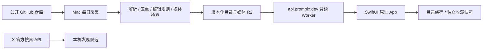

# Prompix 技术方案 v0.6

更新：2026-10-11。iOS Native、多模态、Mac 本地轻量采集；不依赖复杂 Agent。0.1.0 已安装至 iPhone Air，0.2.0 接入真实社区内容和线上更新。

## 当前架构

- `prompix.dev` 为品牌主域名，本轮仅启用 `api.prompix.dev`；官网与上架支持页后续建设。
- `services/content/` 是只读 Worker，绑定专用 `prompix-content` R2 bucket。无公开写入接口、用户数据库或登录。
- Mac 用户级 launchd 每天本机时间 08:00 执行采集；机器睡眠或关机时不能保证准点执行。运行环境独立安装在仓库外，不依赖临时 worktree。
- 本机凭据位于 `~/.config/prompix/*.env`，候选、发布目录、日志位于 `~/.local/share/prompix/`，均不进入 Git。

## 内容采集与选编

`ingest/sources.ts` 明确列出来源：YouMind OpenLab 的 Nano Banana Pro、GPT Image 2、Seedance 2 公开仓库，以及 prompts.chat CSV。每次解析固定 commit 的文件，保留作者、原始链接、上游仓库与版本。

YouMind 公开的 [同步工作流](https://github.com/YouMind-OpenLab/awesome-nano-banana-pro-prompts/blob/main/.github/workflows/update-readme.yml) 每 4 小时将其 CMS 内容导出到 GitHub，另有审核投稿同步；公开仓库并不等于完整的 X 采集系统。本项目独立实现来源适配、编辑规则和发布流程。

`npm run daily` 只采集和本地预览；`npm run daily -- --publish` 额外镜像媒体并发布。完整库选择使用当前指纹编辑记录、内容条件与全局去重，不再截断每个来源或模态的条数。编辑优先级与上游标记控制排序，四类内容交错展示；未经整理的候选不会直接上线。内容状态记录候选、已审、合格、准备发布和实际发布的分类型数量，以及相对线上已校验目录的新增／移除数。相同版本重复运行明确记为零新增。

X 使用专用应用的 app-only Bearer Token，单日最多一次检索、10 条结果，不自动重试收费请求，不扩展用户资料。先写入当日尝试记录，再请求，失败不推进帖子游标。X 结果只进入本机发现候选，不直接作为已获许可的完整 Prompt 发布。当前账户缺额度时得到 HTTP 402，其他来源照常运行。

原始内容只当数据处理，采集器不执行 Prompt 或网页代码。媒体下载限制来源主机、跳转主机、大小、超时和文件类型；图片用系统 sips 生成最长边 1200 px 的 JPEG，视频校验 MP4 头并限制 60 MB。抓取失败保留来源上次快照，过少有效预览时不切换当前线上版本。

## 发布协议

实际契约以 `packages/schema/catalog.ts` 和 `ios/Prompix/Models/Prompt.swift` 为准。

- `v1/latest.json`：schemaVersion、version、count、publishedAt、sha256、目录 HTTPS URL。
- `releases/<version>/catalog.json`：完整目录、可选 `removedIDs`、来源与媒体元数据。
- `media/<sha256>.jpg|mp4`：内容寻址，跨次运行复用已上传素材。
- 内置原创内容仍可使用 Bundle 资源名；社区预览使用自有 API 域名的 `imageURL`／`videoURL`。

先上传媒体与目录，重新下载目录核对 SHA-256，最后覆盖 latest 指针。失败保持旧版；相同内容版本不重复发布。Worker 仅允许公开路径的 GET／HEAD，支持 ETag 304、视频 Range 206；其他方法返回 405，私有路径返回 404。没有开放任意代理或上传能力。

`npm run remove -- <id> <reason>` 更新本机移除清单，下一次发布启用。客户端应用移除清单时删除对应收藏快照。离线设备只能在联网刷新后获知移除；旧发布文件并非立即物理删除，紧急媒体撤回需额外删除对象并处理缓存。

## iOS 实现

- Swift 6、iOS 17+，无第三方 Swift 依赖。SwiftUI 原生 TabView、NavigationStack、搜索、菜单、分享、编辑与收藏。
- 双列 LazyVStack 信息流，辅助功能大字体改为单列。Tab 使用原创线性模板图标，保留系统原生导航栏；App icon 为原创翻页图形。
- 本地按关键词、类型、用途、模型过滤；专题与相关内容按标签匹配，没有虚构热度或个性化推荐。
- 启动／回到前台检查更新（15 分钟节流）；发现页下拉和设置页手动刷新。检查协议、可信域名、大小、SHA-256 后原子写入目录。异常使用缓存或内置内容。
- 图片按需请求、下采样，NSCache 40 MB、URLCache 磁盘预算 80 MB；原生 UIScrollView 缩放。视频 AVKit 点击播放，离开或进入后台暂停，列表不自动播放。
- 收藏独立 JSON 快照，文字离线可用。已浏览的远程图片受系统缓存淘汰影响，不承诺永久离线；完整视频不离线下载。
- 仅原创网页示例在禁用 JavaScript 的隔离 WKWebView 中展示；外部工具与网页演示打开系统浏览器。
- 用户编辑内容留在当前本地编辑会话；系统分享包含作者、来源链接和许可。没有上传用户输入、分析 SDK 或崩溃 SDK。

## 验证与运维

`npm test`、`npm run typecheck` 检查解析与协议；iOS 单测验证收藏、校验失败、缓存恢复、移除、未知 schema。UI 流程测试覆盖四类内容、编辑复制、收藏重启和真实线上图片／视频入口。`npm run check:deployment` 检查实际线上哈希、完整响应、条件请求、分段视频、HEAD 和只读边界。

安装、日志、故障恢复和费用控制见 [内容运行手册](content-operations.md)。上架前仍需持续内容编辑、网页真实作品、英文界面、旧设备性能、真机网络与播放器错误场景、支持页面和商店材料，不能把本轮管线接通等同于编辑推荐品质。

目录仍采用兼容已安装客户端的 v1 协议：最多 1,000 条、下载最多 10 MB。完整库超过条数时在上传媒体前失败；目录文件超过大小时在上传／激活目录前失败，保留旧版，不悄悄截断合格内容。达到容量前再演进分片或分页协议。专题封面选择满三张即结束，避免目录扩充后的平方级遍历。
