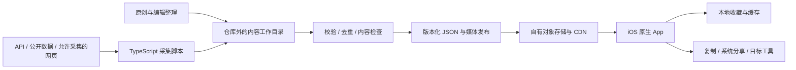

# Prompix 技术方案 v0.5

更新：2026-10-11。方向：原生 iOS、多模态内容、自建轻量采集；视觉方向确认后开始客户端开发。本文件描述计划，仓库当前仍以文档和静态稿为主。

## 1. 架构原则

- 文本、图片、视频、网页使用统一内容协议；展示和使用能力按条目配置。
- iOS Native 优先；HTML 只用于设计讨论或必要的支持页面，不用 WebView 承载主界面。
- 采集、编辑、发布是可以手动运行的确定性脚本；首版不依赖大模型、推荐 Agent、Postgres、Payload 或常驻 Mac mini 服务。
- 内容静态发布、本地收藏；服务异常时保留最近一次有效内容。先做可用的完整路径，再按数据量增加复杂度。

## 2. 总体结构

Cloudflare R2 是对象存储候选，访问方式和视频分发配置在部署时核实。首版优先静态文件，不要求动态 Workers API；完整网页产品和数据库后台均不在首版前置条件中。

## 3. 统一内容协议

使用 TypeScript + Zod 定义并校验发布格式，iOS 使用对应的 Codable 类型；字段契约随版本管理。最小条目包含：

| 字段组 | 内容 |
|---|---|
| 标识 | 稳定 `id`、`kind`（`text` / `image` / `video` / `web`）、状态、创建与更新时间 |
| 发现 | 标题、用途摘要、用途／风格标签、语言、编辑精选与专题 ID |
| Prompt | 原文、可选译文、输入要求、可选参数说明；本地编辑不覆盖原文 |
| 示例 | 文本输入输出、图片、视频、网页截图或演示链接；注明示例来源 |
| 媒体 | URL、缩略图／封面、宽高、格式；视频含时长和文件大小（已知时） |
| 工具 | 模型标识、目标工具、使用说明、可选链接；模型与工具分别记录 |
| 溯源 | 来源 ID、原始 URL、作者、来源版本、许可／授权依据、原文／原创／改写／逆向／未知 |

`kind` 表达用途产出，`preview` 表达预览形式；一条网页 Prompt 可以同时有截图和演示视频。模型和标签是可扩展数据，不把模型品牌做成客户端固定频道。

目录清单包含 `schemaVersion`、内容版本、条目数、文件哈希、分片位置和工具配置。少量内容先发布单个目录 JSON；详情或示例过大再按文件拆分，不预建复杂的 SQLite 快照增量系统。

## 4. 自建轻量采集

按来源编写小型适配器，共用标准化与发布逻辑。流程：

1. 从配置中的允许来源读取 API、CSV／JSON／Markdown 或网页；保留稳定来源 ID 与更新时间，有条件时使用 ETag／Last-Modified。
2. 提取 Prompt、示例、作者、模型、用途和原始链接。模板或演示没有原始 Prompt 时，不能推测后标为原文。
3. 用来源 ID／规范化 URL 和文本哈希去重；不同来源的同一条内容合并来源信息，图片相同但 Prompt 不同的不自动合并。
4. 输出仓库外的 JSON 草稿，供编辑检查或补充；无法解析的记录进入错误报告，不猜测缺失字段。
5. 校验四类条目必需字段与预览可用性、处理媒体并输出待发布版本。
6. 明确执行发布命令后上传；验证通过才切换当前版本，失败保留旧版本。

拟定命令为 `collect --source <id>`、`validate`、`publish --dry-run`、`publish`、`remove <id>`。抓取不自动发布；重复运行幂等，有超时、有限重试、按来源限速和结构化日志。单次失败不导致整库清空。先手动触发，再按需要挂简单定时任务。

内容工作目录与发布数据不进 Git；默认放在仓库外 `~/.local/share/prompix/content/`。代码、协议和合成测试样例可以入库。凭据放在 `~/.config/prompix/*.env`。YouMind 是候选来源之一，其网站内部接口不作为已获支持的公共 API。

## 5. 媒体、发布与移除

- 图片生成列表缩略图与详情尺寸；文本条目优先保存真正的示例文本，不要求每条都生成图片。
- 视频先准备封面和可播放版本，保留时长与比例。按内容需要使用 sharp／ffmpeg 等工具，不建设全量转码集群；先验证分发端的播放与分段请求能力。
- 网页默认展示截图／录屏和说明，演示链接在系统浏览器打开。采集与 App 均不执行抓来的代码，不建设在线运行沙箱。
- 发布目录按版本存储，上传并验证文件后最后切换 manifest；保留上一版本以供回退。
- 客户端下载新目录后校验 schema 与完整性，再原子替换本地目录；未知版本或下载失败继续使用旧版。
- 移除条目写入静态移除清单并重发目录；App 联网刷新时应用到缓存和收藏，收藏保留“已不可用”的状态。离线设备无法即时获知移除，不承诺即时撤回。

## 6. iOS 原生实现

- SwiftUI 负责导航、详情、搜索、收藏与设置；最低版本暂沿用 iOS 17，在工程初始化时核实工具链。
- UIKit UICollectionView 承载需要精细复用和预加载的混合瀑布流；共享条目模型，按预览类型选择卡片。
- 图片加载与缓存沿用 Nuke 候选；视频使用 AVFoundation／AVKit。信息流至多一个重点卡片静音播放，离屏、后台或打开详情时停止列表播放器。
- 低数据模式和减少动态效果时关闭自动预览，保留点击播放；不预下载完整视频库。
- 首批数百条内容采用本地 JSON 目录与内存关键词过滤，搜索标题、摘要、Prompt 和标签；不依赖远程语义搜索。规模或性能实测需要时再引入全文索引。
- 收藏保存独立的条目快照、文本和缩略图，可离线查看和复制；视频完整离线与网页交互离线不作承诺。媒体缓存有空间上限与清理入口，清理缓存不误删收藏文本。
- 图片支持原生缩放，视频支持原生播放，网页示例使用系统浏览器；系统分享支持文字和来源链接。
- 编辑 Prompt 只在本机完成，不上传用户填写的姓名、生日等内容。兼容 VoiceOver、动态字体、安全区和原生返回手势。

## 7. 使用与排序

- 所有条目保证复制，提供简单编辑后复制和系统分享；按条目列出适用工具。
- 预填链接必须真机验证后才启用；复制、工具打开和预填是不同能力，不能从通用链接配置推断预填成功。详见 [handoff.md](handoff.md)。
- 首页读取编辑顺序、专题和发布时间，做简单去重与类别穿插；相关条目按用途／标签匹配。
- 不使用个性化模型、本机兴趣学习、地区排序或跨平台热度混算；数据结构保留原始来源指标供编辑参考，不冒充 Prompix 用户行为。

## 8. 运行、监控与成本

开发在当前 Mac 上进行，使用 iOS Simulator 做交互、布局、网络失败和性能初验；目标 App 跳转、真实媒体表现、系统分享与签名安装仍须真机验证。

PostHog／Sentry 沿用观测候选，内测前接入必要事件和崩溃监控；事件仅记录条目 ID、类型和操作，不记录用户编辑内容。采集日志与错误报告先落文件，不建 LLM 调用数据库或 Langfuse 服务。

首版成本按实际存储、图片请求、视频播放流量、托管和开发者账号计量。未验证媒体规模和服务套餐前不沿用旧版十万月活费用估算；付费来源 API 和生成模型调用不作为启动必需项。

## 9. 计划中的仓库结构

| 路径 | 用途 |
|---|---|
| `ios/` | 原生 iOS 工程 |
| `ingest/` | 采集、校验、媒体处理和发布脚本 |
| `packages/schema/` | 内容与 manifest 协议 |
| `site/` | 上架需要的产品、隐私和支持页面 |
| `docs/`、`design/` | 方案、决策、设计参考与验收记录 |

以上目录尚未全部建立。首版不创建 `agent/`、`admin/` 或完整 `web/` 产品骨架。未来 Android 用 Kotlin + Jetpack Compose 独立开发，共用发布协议。

## 10. 实施前置与后续扩展

先确认设计参考和核心页面，再进入工程开发。首批来源可用性、四类种子内容、媒体托管和签名条件在对应里程碑中验证，见 [roadmap.md](roadmap.md)。

管理后台在编辑工作确实需要时引入；复杂运营 Agent 在内容更新与排序成为瓶颈后评估。[旧 Agent 方案](ops-agent.md) 是后续备选，不是本版依赖。
